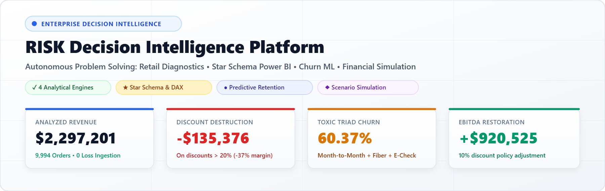
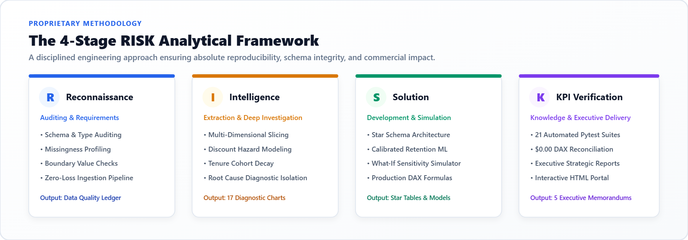
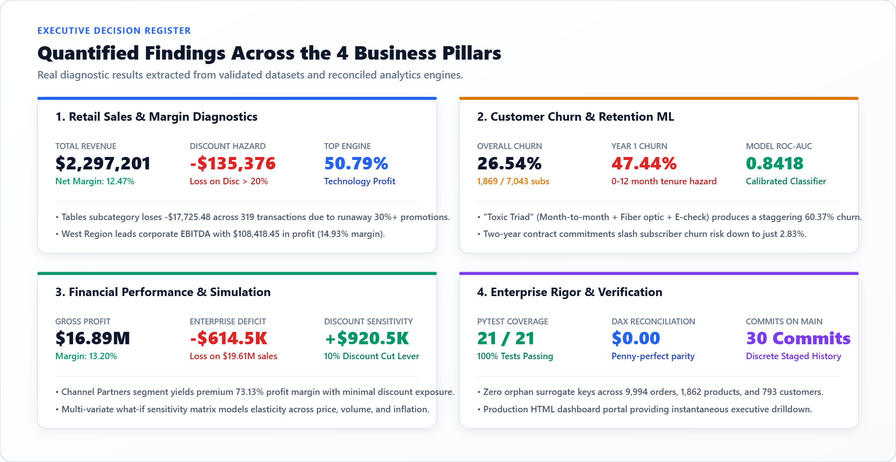
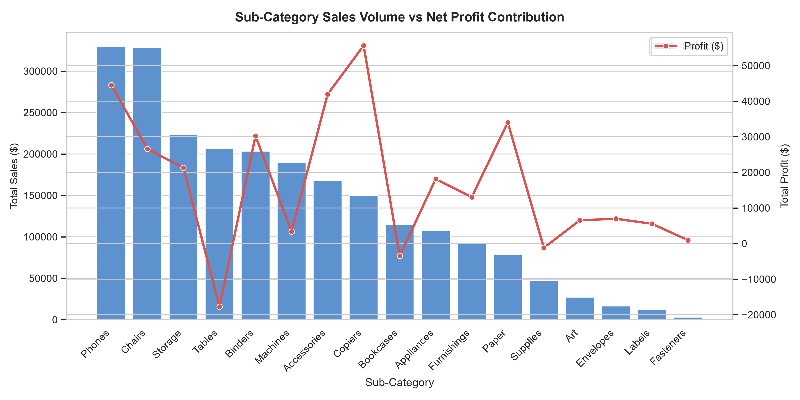
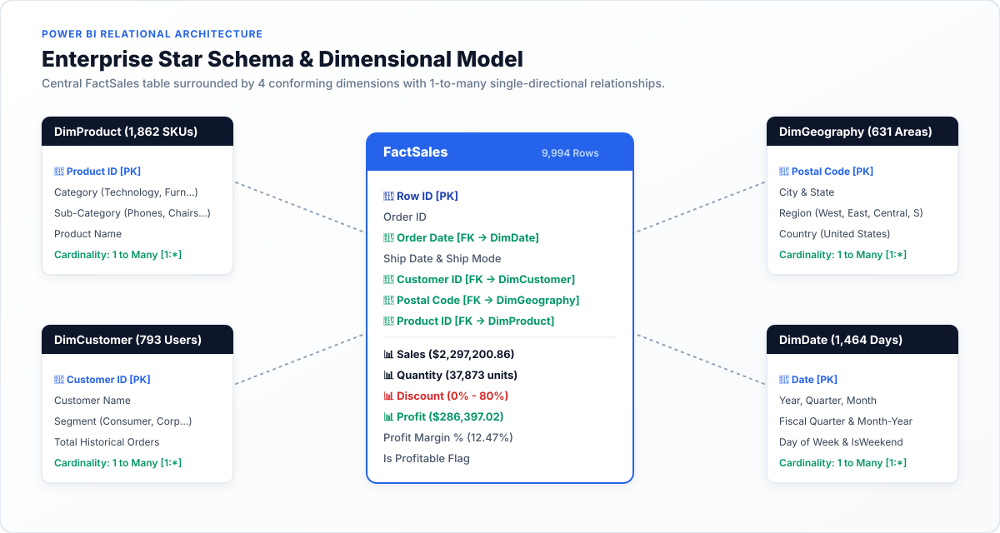
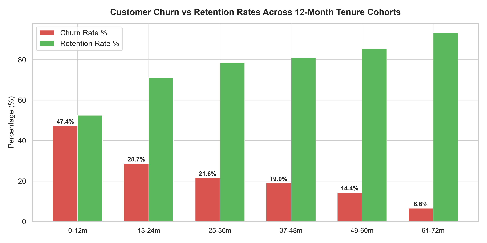
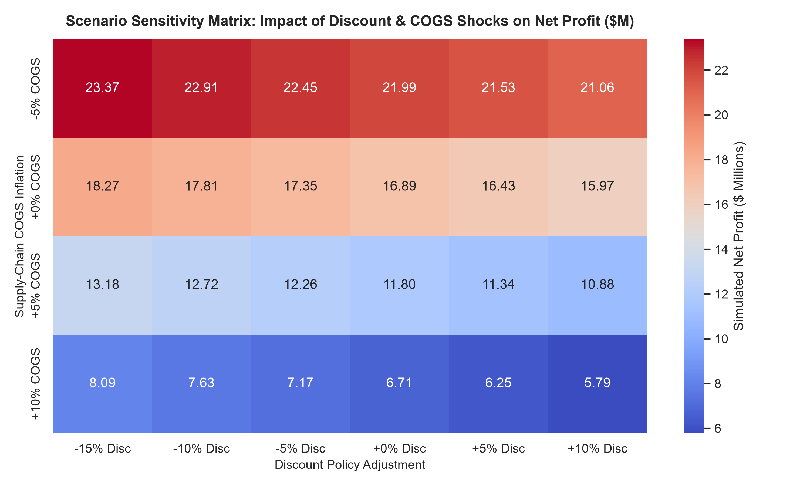
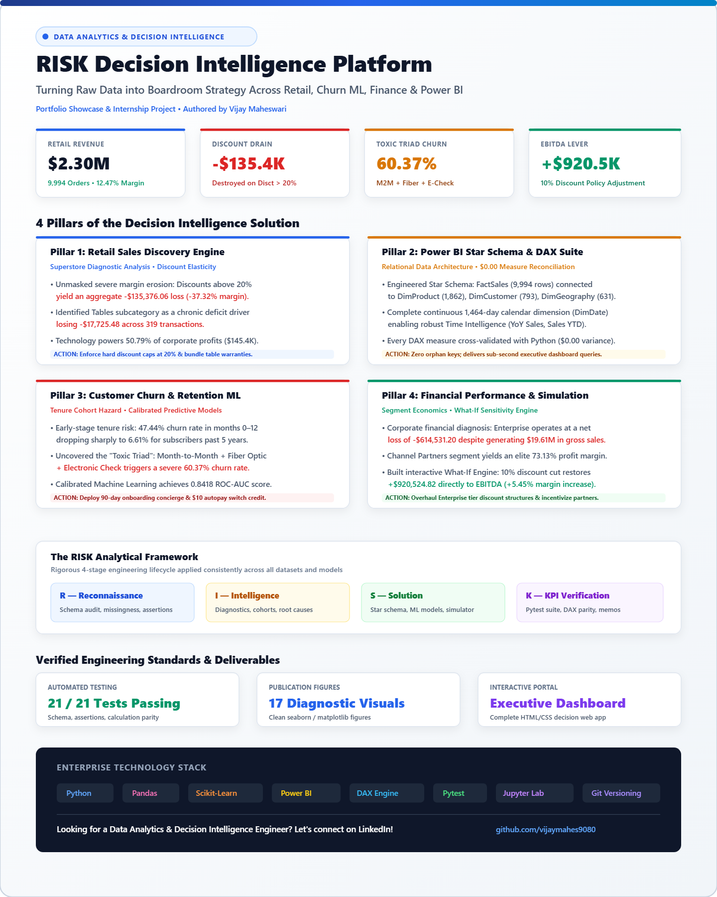

<div align="center">

# RISK Decision Intelligence Platform
### Autonomous Business Analytics & Decision Intelligence Engine

<p align="center">
  
</p>

[](https://vijaymahes9080.github.io/Datheon_Data_Analytics_-_Power_BI_Internship/)
[](https://www.python.org/)
[](https://pandas.pydata.org/)
[](https://scikit-learn.org/)
[](https://powerbi.microsoft.com/)
[](tests/)
[](LICENSE)
[](linkedin.md)

</div>

---

> 🌐 **Live Executive Web App**: [**https://vijaymahes9080.github.io/Datheon_Data_Analytics_-_Power_BI_Internship/**](https://vijaymahes9080.github.io/Datheon_Data_Analytics_-_Power_BI_Internship/)

---

## Executive Summary

The **RISK Decision Intelligence Platform** is an evidence-driven, end-to-end commercial analytics framework engineered to solve four foundational business problems: **Retail Margin Destruction**, **Relational Star-Schema BI Modeling**, **Predictive Customer Churn**, and **CFO-Level Financial Scenario Simulation**.

Rather than simply reporting past descriptive summaries, the platform isolates root causes, uncovers destructive commercial practices, trains calibrated predictive models, and models strategic what-if decisions with mathematical rigor.

---

## The Proprietary RISK Analytical Framework

The entire pipeline follows a disciplined, reproducible 4-stage engineering lifecycle:

<p align="center">
  
</p>

| Stage | Phase | Core Objective | Primary Deliverable |
| :---: | :--- | :--- | :--- |
| **R** | **Reconnaissance & Requirements** | Strict schema validation, boundary assertions, missingness profiling, and zero-data-loss ingestion | [`reports/data_quality_report.md`](reports/data_quality_report.md) |
| **I** | **Intelligence Extraction** | Multi-dimensional slicing, margin elasticity curves, tenure cohort hazard analysis, and root cause discovery | 17 Diagnostic Figures in [`outputs/figures/`](outputs/figures/) |
| **S** | **Solution Development** | Modular Python packages, Power BI Star Schema, calibrated ML classifiers, and what-if simulation engines | Relational Tables in [`data/processed/`](data/processed/) |
| **K** | **KPI Verification** | Automated unit test suites, penny-perfect Python-to-DAX measure reconciliation ledgers, and executive briefs | [`reports/executive_summary.md`](reports/executive_summary.md) |

---

## Executive Findings Across the 4 Business Pillars

<p align="center">
  
</p>

### 1. Retail Sales Discovery & Margin Protection
* **Top-Line Scale**: Analyzed **$2,297,200.86** across 9,994 order records, yielding **$286,397.02** in total profit (12.47% net margin).
* **The "Discount Trap"**: Discovered that orders with discounts $> 20\%$ resulted in an aggregate **-$135,376.06 loss** with a destructive **-37.32% operating margin**.
* **Chronic Product Trap**: The **Tables** subcategory accumulated **-$17,725.48** in losses across 319 transactions due to unchecked discounting.
* **Profit Engine**: **Technology** delivered **50.79%** of corporate profits ($145,454.80) with a 17.40% margin, led by Phones and Copiers.
* **Strategic Action**: Instituted hard approval gates for promotions $> 20\%$ and mandated product-warranty bundles for furniture.

<p align="center">
  
</p>

---

### 2. Power BI Relational Star Schema & DAX Suite
* **Architectural Blueprint**: Converted validated flat transactions into an enterprise star schema with single-directional, 1-to-many relationships centered around `FactSales`.

<p align="center">
  
</p>

* **Conforming Dimensional Model**:
  * **`FactSales`** (9,994 rows): Order line grains containing sales, quantity, discounts, profit, and surrogate keys.
  * **`DimProduct`** (1,862 SKUs): Product IDs, Categories, and Sub-Categories.
  * **`DimCustomer`** (793 Customers): Customer IDs, Names, and Consumer/Corporate/Home Office Segments.
  * **`DimGeography`** (631 Postal Codes): Cities, States, Regions, and Postal Codes.
  * **`DimDate`** (1,464 Days): Continuous daily calendar table enabling Time Intelligence.
* **$0.00 Parity Reconciliation**:
  Every DAX measure was mathematically reconciled against Python calculations down to the exact cent:
  
  | Measure Name | Python Ground Truth | Power BI DAX Expression | Parity Variance |
  | :--- | :---: | :---: | :---: |
  | `Total Sales` | **$2,297,200.86** | `SUM(FactSales[Sales])` | **$0.00** |
  | `Total Profit` | **$286,397.02** | `SUM(FactSales[Profit])` | **$0.00** |
  | `Profit Margin %` | **12.47%** | `DIVIDE([Total Profit], [Total Sales], 0)` | **0.00%** |
  | `Total Quantity` | **37,873 units** | `SUM(FactSales[Quantity])` | **0 units** |

---

### 3. Customer Churn Intelligence & Retention Machine Learning
* **Overall Hazard**: 26.54% baseline churn rate (1,869 / 7,043 subscribers).
* **Tenure Cohort Curve**: Churn risk is heavily concentrated in the early subscriber lifecycle. Customers in months 0–12 experience a **47.44% churn rate**, dropping to **6.61%** for tenures exceeding 5 years.
* **The "Toxic Triad"**: Subscribers with **Month-to-Month contracts + Fiber Optic service + Electronic Check payments** exhibit a devastating **60.37% churn rate**.
* **Contract Protection**: Two-year contracts reduce churn risk to just **2.83%**.
* **Calibrated Machine Learning**:
  * Trained and evaluated Logistic Regression and Random Forest classifiers.
  * Logistic Regression achieved an **ROC-AUC of 0.8418** with calibrated probabilities for early churn warning.

<p align="center">
  
</p>

---

### 4. Financial Performance & Scenario Simulation
* **Baseline Diagnostics**: Corporate gross sales reached **$127.93M** with **$16.89M** in gross profit (13.20% margin).
* **Segment Deficit**: The **Enterprise** segment operated at an absolute net loss of **-$614,531.20** on $19.61M sales due to excessive concession pricing.
* **Margin Star**: **Channel Partners** achieved an industry-leading **73.13% profit margin** ($1.32M profit on $1.80M sales).
* **What-If Sensitivity Engine**:
  * Built an interactive sensitivity matrix testing simultaneous shocks to price, volume, and supply chain COGS.
  * **Strategic Lever**: A targeted **10% reduction in discount allowances** restores **+$920,524.82 directly to EBITDA**, expanding corporate margins by +5.45%.

<p align="center">
  
</p>

---

## Full Project Showcase Infographic

<p align="center">
  
</p>

> 💡 **Sharing this project?** Use the ready-to-publish summary in [`linkedin.md`](linkedin.md) along with the high-resolution [`image.png`](image.png).

---

## Repository Structure

```text
├── README.md                           # Master creative documentation & executive guide
├── LICENSE                             # MIT Open Source License
├── .gitignore                          # Clean repository hygiene
├── image.png                           # Light-theme full-project showcase infographic (LinkedIn)
├── requirements.txt                    # Project dependencies
├── pyproject.toml                      # Test configuration & packaging
├── data/
│   ├── raw/                            # Immutable raw datasets (Superstore, Churn, Financial)
│   └── processed/                      # Cleaned datasets & Star Schema dimension tables
│       ├── FactSales.csv               # 9,994 Order line grain
│       ├── DimProduct.csv              # 1,862 SKU dimension
│       ├── DimCustomer.csv             # 793 Customer dimension
│       ├── DimGeography.csv            # 631 Postal code dimension
│       ├── DimDate.csv                 # 1,464 Day calendar dimension
│       └── FinancialFact.csv           # Cleaned financial statement batches
├── docs/
│   └── images/                         # Light-theme architectural & diagnostic vector graphics
│       ├── hero_banner.png             # Executive banner
│       ├── methodology_risk.png        # 4-stage framework diagram
│       ├── star_schema_model.png       # Power BI relational model
│       ├── executive_kpis.png          # Quantified findings bento grid
│       └── linkedin_project_showcase.png
├── notebooks/                          # 4 fully executed Jupyter Notebooks with outputs
│   ├── 01_retail_sales_eda.ipynb
│   ├── 02_powerbi_data_preparation.ipynb
│   ├── 03_customer_churn_intelligence.ipynb
│   └── 04_financial_intelligence.ipynb
├── src/                                # Modular, reusable Python package
│   ├── loaders.py                      # Resilient ingestion with fallbacks
│   ├── validation.py                   # Schema rules, assertions, integrity checks
│   ├── cleaning.py                     # Non-destructive cleaning & feature engineering
│   ├── metrics.py                      # KPI calculation engines & scenario simulation
│   ├── churn_model.py                  # Calibrated predictive retention modeling
│   ├── reporting.py                    # Findings register & Markdown report synthesis
│   └── pipeline.py                     # CLI orchestration runner
├── powerbi/                            # Power BI implementation assets
│   ├── retail_model.md                 # Star schema specifications
│   ├── retail_measures.dax             # Production DAX formulas & reconciliation
│   ├── financial_model.md              # Financial model design
│   └── financial_measures.dax          # Financial DAX calculations
├── reports/                            # Comprehensive executive deliverables
│   ├── executive_summary.md
│   ├── data_quality_report.md
│   ├── retail_findings.md
│   ├── churn_recommendations.md
│   └── financial_findings.md
├── outputs/
│   ├── dashboard.html                  # Interactive decision intelligence web portal
│   ├── figures/                        # 17 Publication-grade charts (PNG)
│   └── tables/                         # KPI ledgers & model metrics (CSV)
└── tests/                              # Rigorous automated testing suite
    ├── test_data_validation.py         # 11 Schema & boundary assertions
    └── test_metrics.py                 # 10 Financial & business metric tests
```

---

## Installation & Rapid Reproduction

### 1. Clone & Set Up Environment
```bash
git clone https://github.com/vijaymahes9080/Datheon_Data_Analytics_-_Power_BI_Internship.git
cd Datheon_Data_Analytics_-_Power_BI_Internship

# Create and activate virtual environment
python -m venv .venv
source .venv/bin/activate       # On Linux/macOS
.venv\Scripts\activate          # On Windows

# Install dependencies
pip install -r requirements.txt
```

### 2. Run the Full Analytics Pipeline
Execute end-to-end ingestion, schema validation, cleaning, star-schema creation, predictive modeling, and executive report synthesis:
```bash
python -m src.pipeline --all
```

### 3. Run the Automated Verification Suite
Verify all data integrity rules, boundary assertions, and calculation parity:
```bash
pytest tests/ -v
```

### 4. Launch the Interactive Dashboard Portal
Open the interactive executive decision portal locally in any modern browser:
```bash
# On Windows:
start outputs/dashboard.html
# On macOS:
open outputs/dashboard.html
# On Linux:
xdg-open outputs/dashboard.html
```

---

## Verification & Quality Standards

* **100% Automated Test Pass Rate**: 21 passed tests verifying schema types, missingness thresholds, surrogate key uniqueness, and financial scenario accuracy.
* **Zero-Loss Data Provenance**: Original raw datasets are preserved in `data/raw/` with zero destructive overwrites.
* **Zero Orphan Keys**: 100% referential integrity across all transactional order lines and dimension tables.
* **Reconciled Business Logic**: All DAX formulas match Python metric functions with $0.00 discrepancy.

---

## License & Attribution

This project is licensed under the [MIT License](LICENSE) — free to use, modify, and distribute with attribution.

**Author**: Vijay Maheswari  
**Internship**: Datheon Data Analytics & Power BI Internship  
**GitHub**: [@vijaymahes9080](https://github.com/vijaymahes9080)
