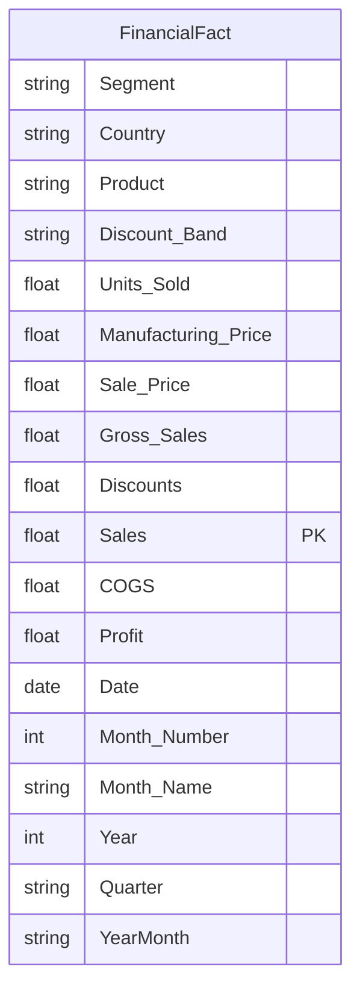

# Power BI Financial Model & Dashboard Architecture Specification

**Framework**: RISK Methodology — Solution Development & Engineering  
**Target Engine**: Microsoft Power BI Desktop / Analysis Services  
**Author**: Vijay Maheswari  

---

## 1. Financial Data Model Architecture

The financial model ingests validated, clean transactional records from `data/processed/FinancialFact.csv` (700 transaction batches spanning 2013–2014, capturing $118,726,350.26 in net commercial revenue).

---

## 2. Table Schema & Column Specifications

* **Table**: `FinancialFact`
* **Grain**: One record per manufacturing/commercial sale batch.
* **Row Count**: 700 batches.
* **Primary Key**: Synthetic composite key `[Segment]-[Country]-[Product]-[Date]`.
* **Key Fields**:
  * `Segment`: Commercial customer tier (`Government`, `Small Business`, `Enterprise`, `Midmarket`, `Channel Partners`).
  * `Country`: Geographic territory (`Canada`, `France`, `Germany`, `Mexico`, `United States of America`).
  * `Product`: Product line SKU (`Carretera`, `Montana`, `Paseo`, `Velo`, `VTT`, `Amarilla`).
  * `Discount Band`: Promotional tier (`None`, `Low`, `Medium`, `High`).
  * `Units Sold`: Physical volume invoiced.
  * `Manufacturing Price`: Per-unit factory production cost ($3.00 to $260.00).
  * `Sale Price`: List price per unit ($7.00 to $350.00).
  * `Gross Sales`: Contractual gross value ($Units Sold \times Sale Price$).
  * `Discounts`: Monetary discount allowance conceded.
  * `Sales` (Net Sales): Statutory net revenue ($Gross Sales - Discounts$).
  * `COGS`: Aggregate cost of goods sold ($Units Sold \times Unit Production/Handling Cost$).
  * `Profit`: Net operating profit contribution ($Sales - COGS$).
  * `Date`: Transaction recognition date.

---

## 3. Power BI Financial Dashboard Page Layouts

### Page 1 — Corporate Financial Overview
* **Target Audience**: Chief Financial Officer (CFO), Board of Directors.
* **Visual Elements**:
  * Top KPI Scorecard Cards:
    * `Net Sales`: **$118.73M**
    * `Total COGS`: **$101.83M**
    * `Operating Profit`: **$16.89M**
    * `Gross Profit Margin %`: **14.23%**
  * Visual 1 (Multi-Line Chart): Monthly trajectory of Net Sales, COGS, and Net Profit ($ Millions) over time.
  * Visual 2 (Bar Chart): Operating Profit by Country showing percentage margin labels.
  * Visual 3 (Donut Chart): Sales revenue share by Customer Segment.
  * Slicers: Date Year/Quarter Slicer, Segment Slicer, Country Slicer.

### Page 2 — Cost, Discount & Margin Diagnostics
* **Target Audience**: Financial Controllers, Procurement Directors, Pricing Strategists.
* **Visual Elements**:
  * Visual 1 (Clustered Column Chart): COGS Ratio (%) across product lines benchmarked against the 85.77% corporate average.
  * Visual 2 (Scatter / Bubble Plot): Effective Discount Rate (%) vs Net Profit Margin (%) across commercial segments.
  * Visual 3 (Matrix Scorecard): Product line breakdown showing Units Sold, Manufacturing Cost, Sale Price, Net Sales, COGS, and Gross Profit Margin %.
  * Visual 4 (Warning Alert Card): **Enterprise Margin Deficit Warning** highlighting the -$614.5K net operating loss.

### Page 3 — What-If Financial Scenario Simulator
* **Target Audience**: Corporate Financial Planning & Analysis (FP&A) Teams.
* **Visual Elements**:
  * Parameter Slicers (What-If Parameters):
    * `Discount Policy Adjustment`: Range -20% to +20% (Step 1%).
    * `COGS Inflation / Deflation Shock`: Range -10% to +15% (Step 1%).
    * `Unit Volume Elasticity`: Range -15% to +20% (Step 1%).
  * Visual 1 (Comparison Gauge / Cards): Baseline Profit ($16.89M) vs Simulated Profit ($).
  * Visual 2 (Waterfall Chart): Bridge decomposition quantifying the variance contributed by Volume, Discount Changes, and Cost Shocks.
  * Visual 3 (Sensitivity Heatmap): Two-dimensional matrix displaying simulated profit outcomes across combinations of Discount and COGS fluctuations.
