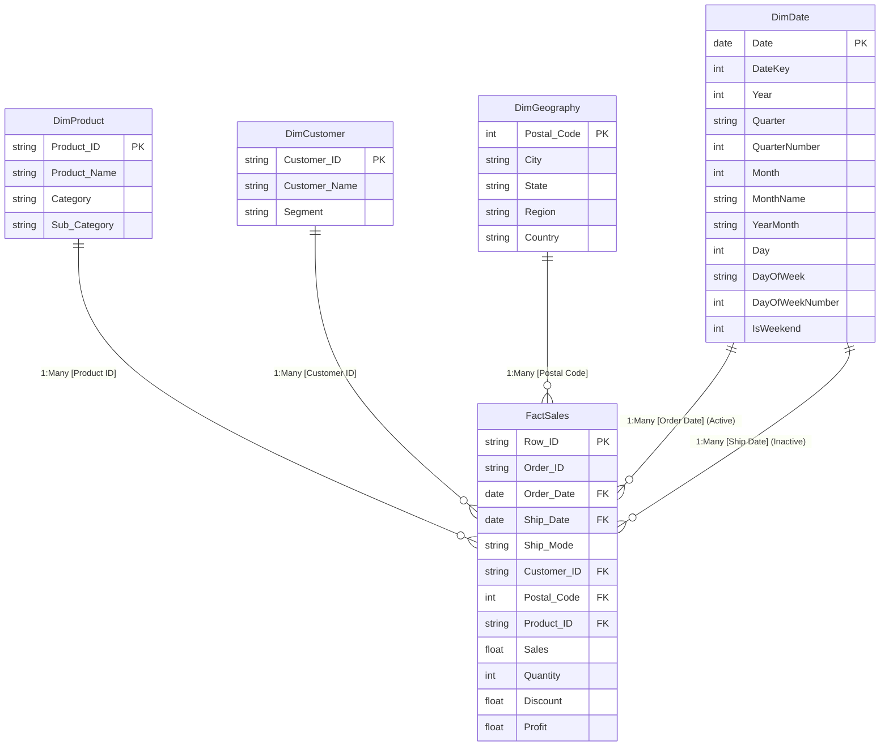

# Power BI Star Schema Relational Data Model Specification: Retail Superstore

**Framework**: RISK Methodology — Solution Development & Engineering  
**Target Engine**: Microsoft Power BI / Analysis Services Tabular Model  
**Author**: Vijay Maheswari  

---

## 1. Relational Star Schema Architecture

The data model conforms strictly to Kimball dimensional modeling principles. Transactional fact records are maintained at the individual order-line item grain within `FactSales`, encircled by four conforming single-grain dimension tables (`DimProduct`, `DimCustomer`, `DimGeography`, and `DimDate`).

---

## 2. Table Dictionaries & Schema Definitions

### FactSales (Transactional Fact Table)
* **Grain**: One record per line item per order.
* **Row Count**: 9,994 records.
* **Storage Path**: `data/processed/FactSales.csv`
* **Column Definitions**:
  * `Row ID` (Primary Key): Unique line-item identifier.
  * `Order ID` (Business Key): Transaction grouping key.
  * `Order Date` (Foreign Key -> `DimDate[Date]`): Date transaction was placed (Active relationship).
  * `Ship Date` (Foreign Key -> `DimDate[Date]`): Date fulfillment shipped (Inactive relationship; activated via `USERELATIONSHIP`).
  * `Ship Mode`: Logistics delivery speed (`Standard Class`, `Second Class`, `First Class`, `Same Day`).
  * `Customer ID` (Foreign Key -> `DimCustomer[Customer ID]`).
  * `Postal Code` (Foreign Key -> `DimGeography[Postal Code]`).
  * `Product ID` (Foreign Key -> `DimProduct[Product ID]`).
  * `Sales` (Numeric): Line-item gross invoiced revenue after discount.
  * `Quantity` (Integer): Number of units purchased.
  * `Discount` (Numeric): Rate of discount applied (0.00 to 0.80).
  * `Profit` (Numeric): Net operating profit contribution from the order line.

### DimProduct (Conforming Dimension)
* **Grain**: One record per distinct Product SKU.
* **Row Count**: 1,862 unique SKUs.
* **Storage Path**: `data/processed/DimProduct.csv`
* **Fields**: `Product ID`, `Product Name`, `Category` (`Furniture`, `Office Supplies`, `Technology`), `Sub-Category` (17 distinct categories).

### DimCustomer (Conforming Dimension)
* **Grain**: One record per unique customer account.
* **Row Count**: 793 distinct customer accounts.
* **Storage Path**: `data/processed/DimCustomer.csv`
* **Fields**: `Customer ID`, `Customer Name`, `Segment` (`Consumer`, `Corporate`, `Home Office`).

### DimGeography (Conforming Dimension)
* **Grain**: One record per unique Postal Code / City / State / Region.
* **Row Count**: 631 unique geographic zones.
* **Storage Path**: `data/processed/DimGeography.csv`
* **Fields**: `Postal Code`, `City`, `State`, `Region` (`West`, `East`, `Central`, `South`), `Country` (`United States`).

### DimDate (Conforming Calendar Dimension)
* **Grain**: One record per continuous calendar day spanning minimum order date (2014-01-03) to maximum fulfillment date (2018-01-05).
* **Row Count**: 1,464 continuous days.
* **Storage Path**: `data/processed/DimDate.csv`
* **Fields**: `Date`, `DateKey`, `Year`, `Quarter`, `QuarterNumber`, `Month`, `MonthName`, `YearMonth`, `Day`, `DayOfWeek`, `DayOfWeekNumber`, `IsWeekend`.

---

## 3. Relationship Specifications

| From Table | From Column | To Table | To Column | Cardinality | Cross Filter Direction | Status |
| :--- | :--- | :--- | :--- | :--- | :--- | :--- |
| `FactSales` | `Product ID` | `DimProduct` | `Product ID` | Many to One (*:1) | Single (`DimProduct` filters `FactSales`) | Active |
| `FactSales` | `Customer ID` | `DimCustomer` | `Customer ID` | Many to One (*:1) | Single (`DimCustomer` filters `FactSales`) | Active |
| `FactSales` | `Postal Code` | `DimGeography` | `Postal Code` | Many to One (*:1) | Single (`DimGeography` filters `FactSales`) | Active |
| `FactSales` | `Order Date` | `DimDate` | `Date` | Many to One (*:1) | Single (`DimDate` filters `FactSales`) | Active |
| `FactSales` | `Ship Date` | `DimDate` | `Date` | Many to One (*:1) | Single (`DimDate` filters `FactSales`) | Inactive |

---

## 4. Power BI Dashboard Page Specifications

### Page 1 — Executive Overview
* **Target Audience**: Chief Executive Officer, Chief Commercial Officer.
* **Visual Elements**:
  * Top KPI Cards: `Total Sales ($2.30M)`, `Total Profit ($286.4K)`, `Profit Margin % (12.47%)`, `Total Orders (5,009)`.
  * Visual 1 (Line Chart): Monthly sales revenue & profit trend over time using `DimDate[YearMonth]`.
  * Visual 2 (Bar Chart): Regional profit contribution comparison with margin % data labels.
  * Visual 3 (Donut Chart): Sales contribution by customer segment.
  * Interactivity: Date Range Slicer, Region Slicer (`West`, `East`, `Central`, `South`).

### Page 2 — Product Intelligence & Margin Diagnostics
* **Target Audience**: VP Merchandising, Supply Chain Directors.
* **Visual Elements**:
  * Visual 1 (Treemap): Revenue volume partitioned by Category and Sub-Category.
  * Visual 2 (Matrix Table): Product Sub-Category commercial scorecard displaying Sales, Profit, Quantity, and Profit Margin %.
  * Visual 3 (Scatter Plot): Transaction Discount vs Net Profit with zero-profit threshold benchmark line.
  * Visual 4 (Warning Card): Loss-leader highlight isolating the Tables subcategory (-$17.7K).

### Page 3 — Customer Intelligence & Concentration
* **Target Audience**: VP Sales, Account Directors.
* **Visual Elements**:
  * Visual 1 (Clustered Column Chart): Average Order Value (AOV) across segments.
  * Visual 2 (Table): Top 20 enterprise accounts by gross revenue and profit margin.
  * Visual 3 (Map Visual): Geography bubble map sized by `Total Sales` and colored by `Profit Margin %`.

### Page 4 — Performance Monitoring & Time Intelligence
* **Target Audience**: Financial Planning & Analysis (FP&A) Managers.
* **Visual Elements**:
  * Visual 1 (Bar Chart): Year-over-Year (YoY) Revenue Growth % by Fiscal Quarter.
  * Visual 2 (Waterfall Chart): Sales variance from prior year to current year.
  * Visual 3 (Table): Monthly growth tracking showing `Sales MTD`, `Sales QTD`, `Sales YTD`.
